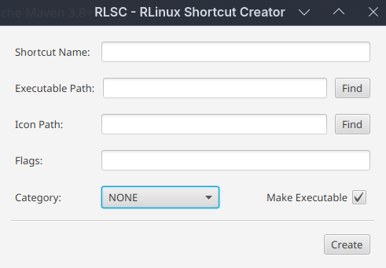

# RLSC (RLinux Shortcut Creator)

A graphical utility to create and manage desktop shortcuts (`.desktop`) for AppImages and binaries on Linux, integrating them directly into the system menu.

<center>
    
</center>


## Features

- Creates and validates `.desktop` files in compliance with Freedesktop specifications.
- Supports custom launch flags and environment prefixes (such as `gamemoderun`, `prime-run`, `mangohud`).
- Freedesktop standard categories (Utility, Game, Development, Office, etc.).
- Custom icon selection with automatic fallback to `application-x-executable`.
- Optional automatic execution permission (`chmod +x`) on the target binary.
- Immediate system menu cache updates (`update-desktop-database` and `kbuildsycoca6` for KDE Plasma environments).

## Interface



## Installation and Usage

### AppImage (Universal Linux)

1. Download `RLSC-x86_64.AppImage` from the [Releases](https://github.com/Eu_Ronald123/RLSC/releases) page.
2. Grant execution permission:
   ```bash
   chmod +x RLSC-x86_64.AppImage
   ```
3. Run the AppImage:
   ```bash
   ./RLSC-x86_64.AppImage
   ```
*Note: The AppImage contains an embedded Java runtime. You do not need Java installed on your system to run it.*

### Arch Linux (Manual Package)

Download `rlsc-bin-1.0.0-1-x86_64.pkg.tar.zst` from the [Releases](https://github.com/EuRonald123/RLSC/releases) page and install it with:

```bash
sudo pacman -U rlsc-bin-1.0.0-1-x86_64.pkg.tar.zst
```

(AUR package coming soon once registrations reopen).

## Building from Source

### Prerequisites
- Java Development Kit (JDK) 21 or higher
- Apache Maven 3.8+
- `appimagetool` and `zip` (only required if building AppImage or AUR binary zip)

### Run in development mode
```bash
mvn javafx:run
```

### Run unit tests
```bash
mvn test
```

### Build distribution packages (Zip and AppImage)
Run the build script at the root of the project:
```bash
./build.sh
```

Generated packages will be placed in the `target/` directory:
- `packaging/appimage/RLSC-x86_64.AppImage`: Standalone universal AppImage.
- `target/rlsc-linux-bin.zip`: Pre-built binary package used by the AUR PKGBUILD.

## Technologies Used

- **Java 21**: Core application language.
- **OpenJFX 21**: User interface framework.
- **Maven**: Build and dependency management.
- **JUnit 5**: Unit test suite for `.desktop` entry generation.
- **jlink**: Custom lightweight Java runtime generator.
- **appimagetool**: AppImage packaging.

## License

This project is licensed under the MIT License. See the [LICENSE](LICENSE) file for details.
